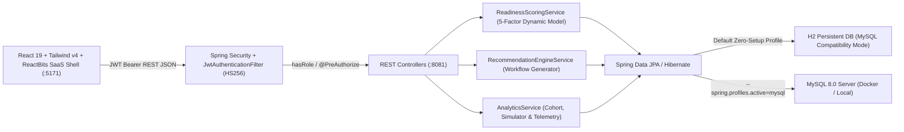

# PrepPulse Analytics — Placement Readiness Intelligence SaaS Platform


> **An investor-grade full-stack placement intelligence SaaS platform** engineered with **Spring Boot, MySQL, JWT RBAC, and React 19** — combining a **multi-workspace enterprise shell**, **first-class Dark / Porcelain Light Mode**, **`Ctrl+K` Command Palette**, **live metered quotas & developer API keys**, and **dynamic 5-factor placement readiness scoring**.

---

## Architecture Overview



---

## Investor-Grade SaaS Platform Capabilities

- **First-Class Obsidian Dark & Porcelain Studio Light Mode (`ThemeContext` + `ThemeToggle`)**:
  - Zero-FOUC inline theme hydration persisted in `localStorage` (`preppulse_theme`).
  - Animated Framer Motion Sun/Moon spring toggle synchronized across every dashboard card, modal, table, Recharts visualization (`AreaChart`, `RadarChart`, `BarChart`, `LineChart`), and ReactBits canvas (`Aurora`, `Squares`, `SpotlightCard`, `Dock`, `BorderBeam`, `StarBorder`, `PillNav`).
- **Full SaaS Marketing & Product Splash Page (`LandingSplash`)**:
  - Sticky frosted top navbar with smooth-scroll links (*Features*, *Analytics*, *Pricing*, *FAQ*), live Spring Boot status pill, Dark/Light Mode switch, and Sign In / Launch Workspace CTAs.
  - Infinite **Trusted-By Campus & Placement Partners Marquee**, **Monthly / Annual (-20%) SaaS Pricing Tiers** (*Campus Starter*, *Placement Pro* with `BorderBeam`, *University Enterprise*) wired into the Auth Onboarding Modal, and an interactive **Security & FAQ Accordion**.
- **Multi-Workspace Enterprise App Shell (`App.jsx`)**:
  - **Collapsible SaaS Left Sidebar** (desktop icon rail + mobile drawer) with **Multi-Cohort Workspace Switcher** (*Anna Univ — ECE 2027*, *Campus Placement Cell*, *FAANG Sprint Cohort*), categorized navigation, and live Plan Quota mini-bar.
  - **Enterprise Command Header** featuring a live **API Latency & Health Pill** (real round-trip `ms` ping to `GET /api/health`), **Notifications & Activity Drawer** derived from live readiness telemetry, Role/Profile menu, and toggleable floating ReactBits **`Dock`**.
- **Global Keyboard-Driven `Ctrl+K` / `⌘K` Command Palette (`CommandPalette.jsx`)**:
  - Navigate tabs, switch Student/Mentor/Admin RBAC demos, toggle Dark/Light Mode, trigger live AI recommendation regeneration (`POST /api/recommendations/generate`), export CSV/JSON reports, or jump to Billing & API Keys without touching the mouse.
- **Workspace Settings, Plan Quotas, Developer API Keys & Data Exports (`SaaSSettingsTab.jsx`)**:
  - **Appearance & Workspace**: Visual Dark/Light theme studio cards, floating dock toggle, and organization/batch branding editor.
  - **Plan & Metered Usage Quotas**: Active subscription card, interactive Plan Upgrade modal, live usage bars wired to real backend database counts, and Invoice Ledger.
  - **Developer API Keys & Webhooks**: Generate/reveal/copy/revoke `pp_live_...` API tokens, run live REST latency probes against `http://localhost:8081/api/health` & `/api/public/stats`, and configure outbound event webhooks.
  - **One-Click CSV / JSON Exports & Audit Trail**: Real downloadable `.csv` and `.json` placement readiness reports built directly from live backend dashboard payloads alongside a timestamped session audit log.

---

## Core Backend Engineering Highlights

- **Scalable Placement Analytics Backend (`Spring Boot + MySQL + REST APIs`)**: Clean layered JPA architecture (`User`, `AssessmentRecord`, `CodingActivity`, `SkillSnapshot`, `Recommendation`, `MentorFeedback`) with MySQL 8 DDL schema (`backend/mysql-schema.sql`), Docker Compose (`backend/docker-compose.yml`), and zero-setup persistent H2 MySQL-mode fallback.
- **Stateless JWT Authentication & Role-Based Access Control (`RBAC`)**: JJWT `HS256` token generation/validation, BCrypt password hashing, stateless `SecurityFilterChain`, and method-level `@PreAuthorize` enforcement separating `STUDENT`, `MENTOR`, and `ADMIN` scopes.
- **Dynamic 5-Factor Readiness Scoring Engine (`ReadinessScoringService`)**:
  - **Weighted Assessment Performance (35%)**: Recency-weighted & difficulty-adjusted average across 6 domains (`APTITUDE`, `DSA_CODING`, `CORE_CS`, `SQL_DBMS`, `SYSTEM_DESIGN`, `MOCK_INTERVIEW`).
  - **Assessment Momentum Slope (10%)**: Linear regression trend across the latest 6 assessments.
  - **Difficulty-Weighted Coding Analytics (30%)**: Weighted problem mastery (`Easy × 1.0 + Medium × 2.5 + Hard × 4.5`), accuracy rate, and weekly consistency streak.
  - **Skill Progression & Core CS Mastery (15%)**: Historical readiness velocity combined with Core CS / DBMS / System Design performance.
  - **Academic & Mock Interview Baseline (10%)**: CGPA normalization paired with technical/behavioral mock scores, plus completed preparation workflow boosts.
  - **Target Tier Gap Analysis & What-If Simulator**: Live gap computation against **Service (≥65)**, **Product (≥78)**, and **FAANG (≥88)** benchmarks with interactive trajectory simulation (`POST /api/simulator/readiness`).
- **Analytics-Driven Recommendation Workflows (`RecommendationEngineService`)**: Automatically diagnoses weak categories, coding accuracy dips, score plateaus, and target-tier gaps to produce prioritized action plans (`CRITICAL`, `HIGH`, `MEDIUM`, `LOW`). Marking milestones complete dynamically recalculates the student's live Readiness Index.

---

## One-Click Launch (Windows)

Simply double-click **`start.bat`** in the project root (or run it from a terminal):

```cmd
start.bat
```

What `start.bat` does automatically:
1. Verifies Java 21+ and Node.js availability.
2. Runs `npm install` in `frontend/` automatically if `node_modules` is missing.
3. Starts the Spring Boot backend (`mvnw.cmd spring-boot:run`) on **`http://localhost:8081`**.
4. Starts the Vite + React frontend (`npm.cmd run dev`) on **`http://localhost:5171`**.
5. Polls `/api/health` until live and automatically opens **`http://localhost:5171`** in your default browser.

---

## Switching to Real MySQL 8.0

By default, the backend persists cleanly to `./backend/data/placementdb.mv.db` using H2 in **MySQL Compatibility Mode** so the project works instantly with zero external database setup.

To run against a real **MySQL 8.0** server:

```bash
# 1. Start MySQL 8 via Docker Compose (auto-initializes placement_readiness_db)
cd backend
docker compose up -d

# 2. Launch Spring Boot with the mysql profile
mvnw.cmd spring-boot:run -Dspring-boot.run.arguments="--spring.profiles.active=mysql"
```

---

## Demo Accounts (Seeded Automatically)

Use the **1-Click Role Demo Chips** inside the app's Splash Page, Auth Gate, or `Ctrl+K` Command Palette:

| Role | Name | Email | Password | Capabilities |
| :--- | :--- | :--- | :--- | :--- |
| **STUDENT** | **Dharshini A** (ECE, CGPA 8.2, 512 LC) | `dharshini@placement.edu` | `Student@123` | Full Readiness Dashboard, Log Assessments/Coding, What-If Simulator, AI Prep Workflows, CSV/JSON Export |
| **MENTOR** | **Dr. Karthik Sundaram** | `mentor@placement.edu` | `Mentor@123` | Cohort Leaderboard, Department Benchmarks, Student Drill-Down, Mentor Coaching Feedback |
| **ADMIN** | **Placement Cell Director** | `admin@placement.edu` | `Admin@123` | All Mentor powers + Admin Platform Benchmarks & RBAC User Role Management |

---

## REST API & RBAC Reference

| Method | Endpoint | Required Role | Description |
| :--- | :--- | :--- | :--- |
| `GET` | `/api/health` | Public | Backend health telemetry & latency probe |
| `GET` | `/api/public/stats` | Public | Live cohort KPI summary for landing page |
| `POST` | `/api/auth/login` | Public | Authenticate & issue HS256 JWT token |
| `POST` | `/api/auth/register` | Public | Register account & bootstrap starter analytics |
| `GET` | `/api/dashboard/me` | Authenticated | Full dynamic readiness breakdown, charts, assessments, coding & insights |
| `PUT` | `/api/dashboard/target-tier` | Authenticated | Update target placement tier (`SERVICE`, `PRODUCT`, `FAANG`) |
| `POST` | `/api/simulator/readiness` | Authenticated | What-If Readiness trajectory simulation |
| `POST` | `/api/assessments` | Authenticated | Log new assessment & recalculate Readiness Index |
| `DELETE` | `/api/assessments/{id}` | Authenticated | Delete assessment & recalculate Readiness Index |
| `POST` | `/api/coding` | Authenticated | Upsert topic coding volume, accuracy & streak |
| `POST` | `/api/recommendations/generate` | Authenticated | Run analytics engine to refresh personalized recommendations |
| `PATCH` | `/api/recommendations/{id}/toggle` | Authenticated | Toggle completion & return updated Readiness Index |
| `GET` | `/api/cohort/overview` | `MENTOR`, `ADMIN` | Cohort leaderboard, band & department analytics |
| `GET` | `/api/cohort/students/{id}/analytics` | `MENTOR`, `ADMIN` | Inspect any student's full readiness dashboard |
| `POST` | `/api/cohort/feedback` | `MENTOR`, `ADMIN` | Post qualitative coaching note to a student |
| `GET` | `/api/admin/benchmarks` | `ADMIN` | Global platform metrics, database mode & user directory |
| `PATCH` | `/api/admin/users/{id}/role` | `ADMIN` | Update any user's RBAC role |

---

## ReactBits Interactive UI Component Catalog

All 20 custom theme-aware animation & spatial interaction components live in `frontend/src/components/reactbits/`:

`Aurora` • `Squares` • `ClickSpark` • `SplitText` • `BlurText` • `ShinyText` • `GradientText` • `DecryptedText` • `RotatingText` • `CountUp` • `TrueFocus` • `SpotlightCard` • `TiltedCard` • `Magnet` • `StarBorder` • `Dock` • `PillNav` • `AnimatedList` • `GlareHover` • `BorderBeam`

---

## Pushing to GitHub

```bash
git init
git add .
git commit -m "feat: PrepPulse Placement Readiness Intelligence SaaS Platform (Dark/Light Mode, Ctrl+K, Multi-Workspace, API Keys & Exports)"
git branch -M main
git remote add origin https://github.com/<your-username>/placement-readiness-analytics.git
git push -u origin main
```

---

**Author:** Dharshini A • B.E. Electronics & Communication Engineering, Anna University
